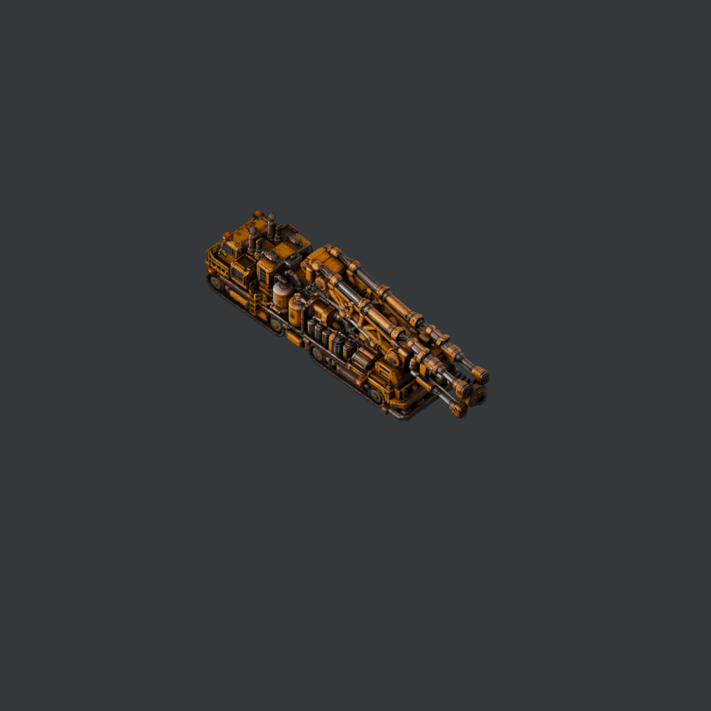

# Нефтебуровая машина

Нефтебур с отдельными походным и рабочим положениями. Бурит существующую нефтяную залежь и устанавливает обычную нефтяную вышку из багажника.

**Это 100% вайбкодинг через Codex (OpenAI): весь код мода создан с помощью ИИ под руководством автора. 3D-модели сгенерированы через Tripo AI.**

[English overview](README.en.md) · [Происхождение графики](CREDITS.md)

## Версия и требования

- Версия мода: **0.4.0**. Factorio 2.0, базовый мод `base`.
- Каждый из трёх модов устанавливается самостоятельно. Space Age не является обязательной зависимостью.
- При установленном Heavy Construction Machinery Plant автоматически добавляется рецепт для его цеха с теми же ингредиентами и исследованием.
- Существующие сохранения поддерживаются: при обновлении рецепты синхронизируются с исследованием «Железная дорога». Уже построенные машины сохраняются.

## Крафт и открытие

Машина открывается технологией **«Железная дорога» (`railway`)**, одновременно с локомотивом. Требуются красные и зелёные исследовательские пакеты. Отдельное исследование и компоненты поздних этапов не нужны.

| Компонент | Количество |
|---|---:|
| Стальные балки | 80 |
| Железные шестерни | 40 |
| Двигатели | 20 |
| Электросхемы | 30 |
| Трубы | 50 |

Время изготовления — **45 секунд**, выход — одна машина. Для сравнения: локомотив требует 30 стали, 20 двигателей и 10 электросхем. Тяжёлая специализированная техника намеренно дороже; это исходный баланс для игровых отзывов.

## Как пользоваться

1. Изготовьте нефтебур после исследования «Железная дорога» и заправьте химическим топливом.
2. Для работы приготовьте одну нефтяную вышку и 10 труб в багажнике. Для изготовления вышки нужно исследовать переработку нефти.
3. В походном режиме поставьте головку над существующей залежью нефти.
4. Включите «Бурение скважины» в интерфейсе машины. Переключение мгновенное: машина останавливается, движение и поворот блокируются.
5. Через 30 секунд оплаченного топливом бурения появляется обычная вышка. Подключите к ней электричество и трубы.
6. По завершении режим отключается автоматически. Для перемещения до завершения вручную выключите бурение; прогресс сбросится.

## Механика

- Два набора по 128 ракурсов: сложенный походный нефтебур и прежняя развёрнутая рабочая модель.
- Весь рабочий режим блокирует движение и поворот, включая ожидание залежи, материалов или топлива. Для езды нужно выключить режим.
- Переход мгновенный, без отдельной анимации раскладывания.
- Дополнительная мощность бурения — 2,4 МВт; базовый двигатель в походном режиме — 600 кВт.
- Бурение не создаёт новые залежи и не увеличивает количество нефти.
- Вышка и трубы расходуются только после успешной установки. Сохраняется качество переданной вышки.
- На месте установки должен быть свободный участок под вышку.
- После отключения возвращаются походная модель, движение и поворот.

## Графика

Исходные материалы моделей сохранены. Спрайты сняты в Blender: ортографическая камера с наклоном 45°, мягкое рассеянное освещение, 128 направлений поворота, одинаковый масштаб на всех ракурсах, отдельные тени, анимация гусениц и рабочего инструмента.

Рецепт машины открыт вместе с поездом; для её работы дополнительно нужна обычная нефтяная вышка из технологии переработки нефти, которая тоже относится к красно-зелёному этапу.

## Установка

Закройте Factorio. Поместите `heavy-oil-well-driller_0.4.0.zip` в папку `mods` пользовательского профиля и включите мод в меню игры. Распаковывать архив не требуется. Для ручной упаковки содержимое этого репозитория должно находиться в каталоге `heavy-oil-well-driller_0.4.0` внутри ZIP.

Исходные большие файлы Blender/USDZ не входят в игровой архив. Все необходимые игре спрайты уже включены.

## Что изменилось в 0.4.0

Крафт и открытие перенесены на «Железную дорогу». Рабочий режим теперь мгновенно и полностью блокирует движение и поворот; походное управление возвращается после выключения режима или завершения скважины.

Игровые тесты этой версии не запускались по просьбе автора; проверка в игре выполняется автором. Если нашли ошибку, приложите версию Factorio, версию мода, список других модов, шаги воспроизведения и соответствующий фрагмент `factorio-current.log`.

## Авторы и инструменты

Автор идеи, требований, выбора моделей и игровой проверки — **artel**. Реализация кода — **100% вайбкодинг через Codex (OpenAI)**. Генерация 3D-моделей — **Tripo AI**. Подготовка сцен и рендер спрайтов — **Blender**. Мод создан для Factorio; он не является официальным продуктом Wube Software.
